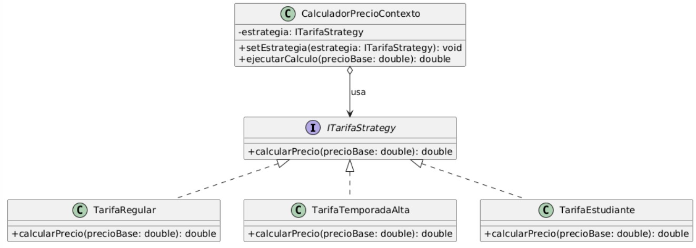
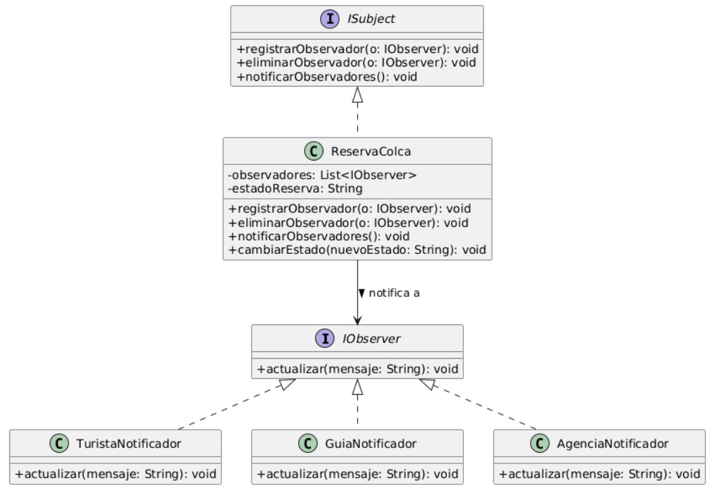

# AG-09 — Informe final: patrones de diseño en RutaColca

**Curso:** Construcción de Software · **Tema 09:** Patrones de diseño · **Caso base:** RutaColca (AG-08)  
**Responsable del informe:** Cristhian Matias Bravo Arredondo — Integrador, verificador y expositor del cierre  
**Fecha:** 2026-10-27 · **Estado:** consolidado, pendiente de revisión del equipo (ver §7)

> Este informe **consolida** los entregables de los integrantes 1, 2 y 3. No modifica sus decisiones técnicas: las diferencias detectadas entre entregables se registran en §7 como puntos a resolver por sus responsables.

## 1. Equipo y entregables

| Integrante | Rol AG-09 | Entregable | Rama / estado |
|---|---|---|---|
| Fernando Gerson Luque Guevara | 1 — Analista de escenarios y coordinador | [`analisis-escenarios.md`](analisis-escenarios.md) | `ag09/analisis` · fusionado en `main` (PR #3) |
| Diego Schreiber | 2 — Diseñador de diagramas UML | [`patron-1.puml`](diagramas/patron-1.puml), [`patron-2.puml`](diagramas/patron-2.puml) e [imágenes](diagramas/img/) | Incluido en el PR #3 · fusionado en `main` |
| Giovani Angel Mendoza Contreras | 3 — Evaluador crítico de IA | [`evaluacion-ia.md`](evaluacion-ia.md) | `ag09/evaluacion-ia` · **PR pendiente de fusión** |
| Cristhian Matias Bravo Arredondo | 4 — Integrador y verificador | `informe-final.md` (este archivo) | `ag09/informe` |

**Fuentes:** consigna del *Tema 09: Patrones de diseño*, pp. 33–35; contexto arquitectónico de AG-08 en [`workspace.dsl`](../architecture/c4/ruta-colca/workspace.dsl) e [`inventario.md`](../architecture/c4/ruta-colca/inventario.md).

## 2. Escenarios y decisiones de diseño

Resumen de la matriz del integrante 1 ([`analisis-escenarios.md`, §2](analisis-escenarios.md#2-matriz-de-análisis)). Los nombres de clase son propuestas de diseño, no código existente.

| N.º | Escenario | Problema de diseño | Decisión del equipo | Principio que la justifica |
|---|---|---|---|---|
| 1 | Cobrar con tarjeta, Yape y PayPal | `ReservaService` tendría que conocer las llamadas y formatos de cada proveedor. | Interfaz común `PasarelaPago`; **Adapter** solo para proveedores con API incompatible. **Sin Factory** por defecto. | Programar para interfaces; bajo acoplamiento. |
| 2 | Precio por temporada, grupo o estudiante | Condicionales de tarifas mezclados con la lógica de reservas. | **Strategy** (`PoliticaPrecio` + políticas concretas). | Encapsular lo que varía; abierto/cerrado. |
| 3 | Avisar a turista, guía y agencia al confirmar | La confirmación queda acoplada a cada destinatario y canal. | **Observer** (publicador de `ReservaConfirmada` + tres observadores). | Bajo acoplamiento; abierto/cerrado. |
| 4 | API de AUTOCOLCA incompatible | La lógica del boleto depende de un contrato externo que no se controla. | **Adapter** (`AutocolcaAdapter` implementa `ValidadorBoleto`). | Programar para interfaces; aislar cambios externos. |
| 5 | Cientos de consultas de disponibilidad | Riesgo de añadir caché sin evidencia y mostrar cupos obsoletos. | **Sin patrón**: consulta directa optimizada. Proxy con caché solo si una medición lo justifica. | Simplicidad; evitar la *paternite*. |

**Restricciones que el equipo dejó abiertas** (no se inventan reglas): la consigna no dice si las tarifas se combinan; Observer no garantiza la entrega de los avisos; no se asumen endpoints reales de AUTOCOLCA, Yape ni PayPal.

## 3. Diagramas de clases

Elaborados por el integrante 2. Ambos muestran el contexto/cliente, la abstracción y las clases concretas.

### 3.1 Escenario 2 — Strategy (tarifas)

Fuente: [`diagramas/patron-1.puml`](diagramas/patron-1.puml)

| Rol GoF | Clase en el diagrama |
|---|---|
| Contexto (cliente) | `CalculadorPrecioContexto` — guarda la estrategia y delega `ejecutarCalculo` |
| Estrategia (abstracción) | `ITarifaStrategy` |
| Estrategias concretas | `TarifaRegular`, `TarifaTemporadaAlta`, `TarifaEstudiante` |

### 3.2 Escenario 3 — Observer (notificaciones)

Fuente: [`diagramas/patron-2.puml`](diagramas/patron-2.puml)

| Rol GoF | Clase en el diagrama |
|---|---|
| Sujeto (abstracción) | `ISubject` |
| Sujeto concreto | `ReservaColca` — mantiene la lista de observadores y notifica al cambiar de estado |
| Observador (abstracción) | `IObserver` |
| Observadores concretos | `TuristaNotificador`, `GuiaNotificador`, `AgenciaNotificador` |

## 4. Caso donde no conviene un patrón: escenario 5

**Decisión.** La disponibilidad se consulta directamente con `DisponibilidadService` y el repositorio de datos; primero se optimiza la consulta real (índices). No se agrega un `DisponibilidadProxy`.

**Por qué es *paternite* aplicarlo de entrada.**

- «Cientos de consultas» describe frecuencia, no un cuello de botella medido.
- Un Proxy con caché añade TTL, invalidación y el riesgo de mostrar cupos que ya no existen, justo en el dato más sensible de una reserva.
- Agregar el patrón solo para «mostrar otro patrón» aumenta la complejidad sin resolver un problema demostrado.

**Cuándo se reconsideraría.** Si se miden latencias o saturación: Proxy con caché, TTL e invalidación al cambiar cupos. Incluso entonces, **confirmar** un cupo siempre se valida contra la base de datos, nunca contra la caché.

**Segundo caso de contención.** En el escenario 1 el equipo **descartó la Factory** que sugiere la consigna: no hay evidencia de que los adaptadores se construyan en varios lugares, así que basta seleccionarlos en la configuración.

## 5. Contraste con la IA

Resumen de la evaluación del integrante 3 ([`evaluacion-ia.md`](evaluacion-ia.md)). Herramienta: Antigravity (Gemini y Claude Opus 5.5).

| N.º | Propuesta de la IA | Veredicto del equipo | Motivo |
|---|---|---|---|
| 1 | Interfaz `PasarelaPago` + inyección de dependencias; Adapter/Factory solo con SDK distintos. En la Fase 1 había propuesto Factory. | **Aceptado** | Coincide con el rechazo de Factory; `workspace.dsl` modela una sola pasarela. |
| 2 | Strategy condicionado; en una 2.ª consulta, un `enum` o una tabla de tarifas. | **Aceptado parcialmente** | Se mantiene Strategy; si las reglas resultan ser solo porcentajes, el `enum` bastaría. |
| 3 | Observer con eventos de Spring; en una 2.ª consulta, una sola clase `NotificadorReserva`. | **Corregido** | Se mantiene Observer en el diseño; en una implementación se preferirían los eventos de Spring. |
| 4 | Adapter (`AutocolcaAdapter` → `ValidadorBoleto`). | **Aceptado** | Es exactamente el problema que resuelve Adapter. |
| 5 | Sin patrón: índice y consulta directa; `@Cacheable` solo si se mide. Aportó `SELECT … FOR UPDATE` al reservar. | **Aceptado** | Coincide con el análisis; el bloqueo transaccional es un aporte nuevo a evaluar. |

**Recomendación de la IA no adoptada.** En la 2.ª consulta la IA sugirió descartar Strategy y Observer por complejidad innecesaria (y mencionó *outbox*). El equipo no la adoptó porque las tres reglas de precio y los tres destinatarios son variantes reales del caso; queda documentado cuándo se reconsideraría.

**Errores de la IA detectados por el equipo.** Sobreaplicación inicial de Factory; un error de sintaxis PlantUML al compactar un diagrama; supuestos no verificados (carga de PostgreSQL, pasarelas Culqi/Niubiz que no están en el modelo).

**Limitación declarada.** Las consultas se hicieron en la misma conversación en la que ya se habían elegido patrones, por lo que la IA no respondió desde cero.

## 6. Verificación de la rúbrica (20 puntos)

| Criterio | Pts | Evidencia | Estado |
|---|---|---|---|
| Problemas identificados en los cinco escenarios | 4 | §2; [`analisis-escenarios.md`, §3](analisis-escenarios.md#3-análisis-de-cada-escenario) | ✅ Cumple |
| Patrón adecuado o solución sin patrón, justificada con principios | 4 | §2 (columna de principios); análisis §3 | ✅ Cumple |
| Dos diagramas con roles visibles | 4 | §3; `patron-1.puml`, `patron-2.puml` y sus imágenes | ⚠️ Cumple con observaciones (D1–D3 en §7) |
| Alternativa de IA contrastada y registrada, sin copiarla | 4 | §5; `evaluacion-ia.md` | ⚠️ Cumple al fusionarse su PR (E1–E4 en §7) |
| Caso donde no conviene un patrón, contra la *paternite* | 4 | §4; análisis, escenario 5 | ✅ Cumple |

**Verificaciones técnicas realizadas por el integrante 4**

- [x] Ambos `.puml` tienen `@startuml`/`@enduml` y sus imágenes exportadas corresponden al código fuente (mismas clases y relaciones).
- [x] Los enlaces relativos de este informe apuntan a archivos de `docs/ag09/` y `docs/architecture/` presentes en `main`.
- [ ] El enlace a `evaluacion-ia.md` funcionará cuando se fusione `ag09/evaluacion-ia`.
- [x] Los datos del caso citados (una pasarela, WhatsApp solo hacia el guía, AUTOCOLCA externo) coinciden con `workspace.dsl`.

## 7. Control de calidad: observaciones para los responsables

Estas diferencias **no se corrigieron en este informe** para no cambiar decisiones técnicas sin consultar. Cada una indica a quién le corresponde.

### Diagramas (integrantes 1 y 2)

| ID | Observación | Propuesta |
|---|---|---|
| D1 | `patron-1.puml` no usa los nombres acordados en el análisis §4 (`CalculadorPrecio`, `PoliticaPrecio`, `PrecioTemporada`, `PrecioGrupo`, `PrecioEstudiante`, `ContextoTarifa`). Además **falta la tarifa de grupo**, que es parte del escenario, y aparece `TarifaRegular`, que no lo es. | Renombrar según el análisis y agregar la estrategia de grupo, o actualizar el análisis si el equipo prefiere los nombres del diagrama. |
| D2 | En `patron-2.puml` el sujeto es la entidad `ReservaColca`; el análisis acordó `ReservaService` como cliente, `PublicadorReserva` como sujeto y el evento `ReservaConfirmada`. El rol **cliente** no aparece explícito y `actualizar` recibe un `String` en lugar del evento. | Agregar `ReservaService` y `ReservaConfirmada`, o justificar en el análisis por qué la entidad hace de sujeto. |
| D3 | La relación sujeto → `IObserver` no muestra multiplicidad (`*`), aunque el sujeto mantiene una lista. Las imágenes son `patron1.jpeg`/`patron2.jpeg`, no `patron-1.png`/`patron-2.png` como sugería el procedimiento. | Añadir `"*"` en la relación; el formato de imagen es aceptable si el equipo lo confirma. |

### Evaluación de IA (integrante 3)

| ID | Observación | Propuesta |
|---|---|---|
| E1 | El encabezado dice `Responsable: [tu nombre]` y la carpeta `docs/ag09/evidencias-ia/` está marcada como pendiente y no existe. | Completar el nombre y subir capturas o la exportación del chat antes de fusionar. |
| E2 | Cita archivos que no existen en el repositorio: `escenario2-strategy.puml` y `escenario3-observer.puml` (los diagramas se llaman `patron-1.puml` y `patron-2.puml`). El error de sintaxis de §4 no se observa en los `.puml` actuales. | Actualizar las referencias a los archivos reales. |
| E3 | Usa nombres de clase distintos a los del análisis y los diagramas (`EstrategiaPrecio`, `PublicadorReservas`). | Alinear con los nombres finales que se acuerden en D1–D2. |
| E4 | En el escenario 1 registra la decisión del equipo como «Ninguno», mientras el análisis dice «Adapter cuando las API sean incompatibles, sin Factory». También menciona `ruta.db` y «2 réplicas de `ruta.api`»: verificar que coincidan con `workspace.dsl`. | Integrantes 1 y 3 acuerdan una sola formulación; este informe usa la del análisis. |

### Análisis (integrante 1)

| ID | Observación | Propuesta |
|---|---|---|
| A1 | El encabezado aún dice «propuesta técnica inicial, pendiente de revisión grupal» y la lista de §6 tiene cuatro casillas sin marcar. | Marcarlas cuando D1–D2 y E4 estén resueltas. |

## 8. Síntesis para la socialización (cierre del integrante 4)

1. **Elección de patrones.** Usamos patrones solo donde el problema lo pedía: **Strategy** para tarifas que varían, **Observer** para avisar a varios destinatarios y **Adapter** para AUTOCOLCA y los proveedores de pago incompatibles. El criterio común fue encapsular lo que varía y depender de interfaces.
2. **Decisión sin patrón.** En la disponibilidad elegimos la consulta directa: la frecuencia no prueba que haya lentitud, y una caché arriesgaría mostrar cupos inexistentes. También rechazamos una Factory para pagos sin evidencia que la justifique. Eso es evitar la *paternite*.
3. **Contraste con IA.** La IA coincidió en los escenarios 1, 4 y 5 y aportó ideas útiles (eventos de Spring, bloqueo al reservar). Pero también sobreaplicó Factory, cometió un error de PlantUML y asumió datos sin medir. No copiamos sus respuestas: aceptamos, corregimos o rechazamos cada una con un motivo.
4. **Conclusión.** Un patrón vale por el problema que resuelve, no por aparecer en el diseño. Pensar primero en la solución simple y escalar al patrón cuando el cambio lo exige fue la decisión más importante del equipo.
